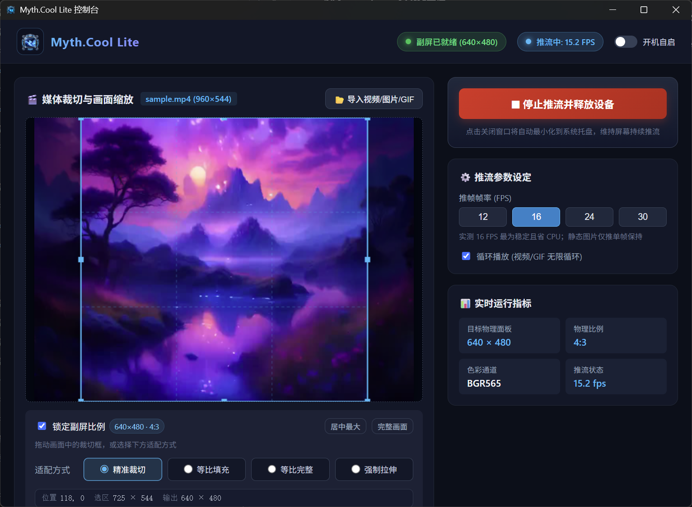

# Myth.Cool Lite

为已适配的电脑副屏 / 水冷屏打造的极轻量推流控制台。

> **使用前请确认型号**：目前明确支持 **瓦尔基里 MC360 水冷屏（`374A:A021`，640×480）**，以及 **[Issue #1 中已实测通过的瓦尔基里机箱前置副屏](https://github.com/ZGMFX01A/MythCool-Lite/issues/1#issuecomment-5788940905)（`345F:9132`，控制器规格 360×960）**。**B360、B360-GT 水冷屏目前不在支持范围内**。同品牌、相同 VID/PID，或能够被程序识别，都不代表兼容。完整范围见下方[兼容性清单](#硬件与驱动兼容性清单)。

---

## 为什么选择 Myth.Cool Lite

官方原版 Myth.Cool 软件常驻后台进程繁多、内存与 CPU 开销巨大，且强制捆绑硬件监控、风扇控制、压力测试、RGB 服务与各类浮动组件，容易导致前台游戏卡顿或系统资源紧张。

**Myth.Cool Lite 只专注做好一件事**：将你喜爱的视频、GIF 动图与静态壁纸，以极低的系统开销稳定推送到副屏/水冷头播放。

### 实测系统资源消耗对比

| 对比项目 | 官方原版 Myth.Cool | Myth.Cool Lite | 优化幅度 |
| :--- | :---: | :---: | :---: |
| **后台常驻进程** | 9 个以上 | **1 个**（纯原生轻量进程） | **减少 ~88%** |
| **内存占用 (RAM)** | ~864 MB | **~35 - 50 MB** | **节省 ~95%** |
| **推流 CPU 占用（单核）** | 26.3% | **~3.2%**（空闲待机趋近 0%） | **降低 ~87%** |
| **安装与运行包体积** | 约 1.08 GB 安装包 | **约 48 MB** 纯正绿色便携包 | **精简 ~95%** |
| **系统盘（C盘）侵入** | 释放数百 MB 缓存与日志 | **零污染、零写入、零解压残留** | 纯净体验 |

---

## 界面预览

---

## 核心功能特性

- **双驱动栈与多设备支持**：
  - **VK 后端（WinUSB 驱动栈）**：适配已验证的 MC360 水冷屏（VID `374A` / PID `A021`，640×480）。
  - **MS 后端（libusb-win32 驱动栈）**：适配 Issue #1 中已验证的瓦尔基里机箱前置副屏（VID `345F` / PID `9132`），使用 64KiB 分块传输与 HID 屏闸控制；不代表支持所有采用 MS9132 方案的设备。
  - **多屏智能识别**：同时连接多台设备时，控制台自动枚举并支持快捷下拉切换目标设备。
- **按已适配屏幕规格缩放与裁切**：
  - 当前使用 VK 640×480 与 MS 控制器 360×960（显示画布 960×360）两套规格，按目标屏幕比例处理媒体；其他分辨率与型号尚未验证，不承诺自动适配。
- **交互式 Canvas 裁切与 4 种画面适配模式**：
  - 支持在可视窗内自由拖拽选区裁切框，并支持锁定副屏原生比例（或 1:1、4:3、16:9 自由切换）；
  - 提供 **精准裁切 (Cover)**、**等比填充 (Contain)**、**等比完整 (Center)** 与 **强制拉伸 (Fill)** 一键对齐方案。
- **帧率（FPS）动态调节**：
  - 支持 12 / 16 / 24 / 30 FPS 随心切换（实测 16 FPS 既能保证动态画面顺滑，又能将 CPU 占用压制到极低；静态图片仅需单帧保持）。
- **系统托盘常驻与静默自启**：
  - 点击右上角关闭窗口自动最小化至 Windows 系统托盘，后台持续稳定推流不黑屏；
  - 勾选“开机自启”即可随系统以 `--minimized` 模式静默开机运行，开机即自动点亮副屏。
- **关机与异常保护**：
  - 严格拦截与平滑处理 Windows 关机/注销信号，消除旧版关机时可能的内存崩溃弹窗；
  - 推流异常或中止时自动复位屏幕通道（`abort_arm`），防止副屏黑屏留存或状态失步。

---

## 下载与使用方式

### 1. 下载

前往 [GitHub Releases](https://github.com/ZGMFX01A/MythCool-Lite/releases) 下载最新发布的绿色便携包：
- **`MythCoolLite-Portable.zip`**（约 48 MB，免安装开箱即用，已内置精简推流解码内核与启动脚本）。

### 2. 使用步骤

1. **解压**：将 `MythCoolLite-Portable.zip` 解压到任意目录（建议使用纯英文路径）。
2. **退出原版（重要！）**：使用前请**完全退出官方原版 Myth.Cool（包括右下角托盘图标）**，否则 USB 设备句柄会被原版独占导致连接失败。
3. **启动**：
   - 直接双击运行 **`MythCoolLite.exe`**；
   - 或双击运行 **`start-portable.cmd`**（该脚本会自动检测并清理原版占用进程后启动）。
4. **播放**：
   - 点击界面左上方的 **「导入视频/图片/GIF」** 选择媒体；
   - 在左侧画布上调整裁切选区或点击适配模式；
   - 点击右侧绿色 **「开始推流到屏幕」** 按钮，副屏即刻开始播放！

---

## 硬件与驱动兼容性清单

**支持范围以已验证的具体设备为准，不按品牌、芯片系列或 VID/PID 承诺整系列兼容。**

| 具体设备 | 硬件 ID (VID / PID) | 屏幕规格 | 驱动通道 | 支持状态与依据 |
| :--- | :--- | :--- | :--- | :--- |
| **瓦尔基里 MC360 水冷屏**（USB 设备名 `Vk-Copl-08`） | `374A:A021` | 640×480 | WinUSB | **明确支持**，开发者真机验证 |
| **瓦尔基里机箱前置副屏（Issue #1 的实测设备）** | `345F:9132`，MS912C/MS9132 方案 | 控制器 360×960，显示画布 960×360 | libusb-win32 (`libusb0.sys`) + HID | **明确支持该实测设备**，探针与主程序图片推流[验证通过](https://github.com/ZGMFX01A/MythCool-Lite/issues/1#issuecomment-5788940905)；反馈未提供具体机箱商品型号 |
| **瓦尔基里 B360 水冷屏** | `345F:9132`（用户反馈） | 未验证 | 未完成适配 | **当前不支持**；[Issue #3](https://github.com/ZGMFX01A/MythCool-Lite/issues/3) 反馈数据推送时屏幕仍不亮 |
| **瓦尔基里 B360-GT 水冷屏** | 未提供 | 未验证 | 未完成适配 | **当前不支持**；[Issue #2](https://github.com/ZGMFX01A/MythCool-Lite/issues/2) 反馈黑屏、持续闪烁 |
| **其他型号、硬件版本或分辨率** | 包括与已支持设备相同的 VID/PID | 未验证 | 未验证 | **不在明确支持范围内** |

> **兼容性边界**：相同的 VID/PID 可能用于不同产品。程序能枚举设备、显示“推流中”或统计到 FPS，只能说明识别或数据发送成功，不能证明屏幕已正常点亮、画面正确或控制协议兼容。B360 / B360-GT 的具体不兼容原因尚未确认。

> **驱动提示**：
> - **已支持的 VK 设备**：使用 Windows 的 WinUSB 栈，需确保设备已正确绑定 WinUSB 驱动。
> - **已支持的 MS 设备**：依赖设备配套的 `libusb-win32` 驱动与 `libusb0.dll`，通常由官方软件安装。安装驱动不会让未适配型号自动兼容。

### 维护与适配范围

本项目是个人按自身需求开发、利用业余时间维护的工具。目前没有新增型号的适配计划，也不承诺为未支持的设备进行协议逆向、远程调试或提供适配时间表。未支持型号的兼容性请求可能按不在当前维护范围内关闭。

---

## 常见问题排查 (FAQ)

### Q0: 官方 Myth.Cool 能用，Lite 识别到了设备却黑屏或闪烁？
* **解答**：请先核对上方兼容性清单。官方软件支持某个型号，不代表 Lite 已实现该型号的控制协议；“推流中”和 FPS 也不是画面正常显示的证明。B360 / B360-GT 当前不支持，遇到黑屏或闪烁请停止 Lite 推流并使用官方客户端，当前没有这两款型号的适配计划。

### Q1: 打开程序后提示“设备已被占用”或无法连接副屏？
* **原因**：官方原版 Myth.Cool 仍在后台运行并独占了 USB 设备句柄。
* **解决办法**：
  1. 检查任务栏右下角托盘，右键彻底退出官方 Myth.Cool；
  2. 若仍被占用，可直接运行便携包内的 `start-portable.cmd` 脚本，它会自动终止占用进程并重新拉起推流客户端。

### Q2: 导入大视频时会卡顿吗？支持哪些媒体格式？
* **解答**：支持几乎所有常见媒体格式，包括但不限于 `.mp4`, `.mkv`, `.webm`, `.mov`, `.gif`, `.png`, `.jpg`。程序内置高性能 FFmpeg 流水线，转码在独立工作线程中按帧率流水式输出，不占用额外磁盘空间，即便播放 4K 视频也不会引起 UI 卡顿。

### Q3: 为什么不需要单独安装 FFmpeg 或 Node.js？
* **解答**：便携包内已预先收拢了经过精巧体积裁剪的解码组件（`bin/ffmpeg/`），且客户端采用 Rust 纯原生编译构建，彻底摆脱对 Node.js / Electron 等庞大外部运行时的依赖。

---

## 协议与致谢

- 本项目基于 [MIT License](LICENSE) 开源。
- 视频解码依托于强大的 [FFmpeg](https://ffmpeg.org/) 开源多媒体框架。
- 桌面端框架基于优秀的 [Tauri 2](https://tauri.app/) 与 [Vue 3](https://vuejs.org/)。
